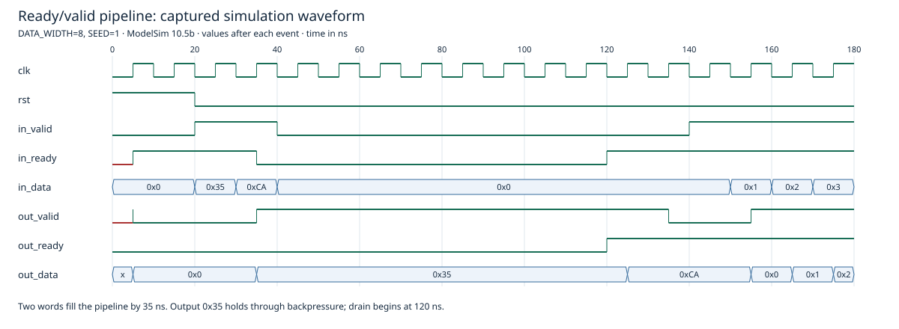

# SystemVerilog RTL Projects

Small RTL designs with readable interfaces and reproducible, self-checking simulation. Prepared for [timfanuel](https://github.com/timfanuel)'s engineering portfolio.

**Current contents:** a parameterized two-stage ready/valid pipeline, a pipelined add–multiply datapath, and an 8N1 UART TX/RX core. Existing RTL is preserved unchanged. The synchronous FIFO and round-robin arbiter were not found in the inspected local folders and are not included or claimed as verified.

| Design | RTL | Verification | Status |
| --- | --- | --- | --- |
| Ready/valid pipeline | [`rtl/rv_pipeline.sv`](rtl/rv_pipeline.sv) | Original randomized scoreboard and added portable regression | 9/9 regression configurations passed; original scoreboard completed without errors |
| Pipelined add–multiply | [`projects/pipelined_arithmetic/rtl/pipelined_mac.sv`](projects/pipelined_arithmetic/rtl/pipelined_mac.sv) | Existing directed and randomized scoreboards | 3 directed cases and 4,025 randomized outputs passed at width 8 |
| UART TX/RX | [`projects/uart/`](projects/uart/) | Serial frame checks, loopback, RX recovery and reset checks | All 256 TX payloads and selected RX/loopback checks passed; basic TX test is smoke only |

## UART project

The [UART project README](projects/uart/README.md) documents the transmitter, synchronized receiver, and combined wrapper for 8N1 serial communication. It includes unchanged RTL, four existing testbenches, two new focused regressions, actual logs, and a captured waveform. From the repository root, run `./projects/uart/sim/run.ps1` (or pass `-Simulator` with the ModelSim executable path). Testing covers TX divider 4 and TX/RX divider 8; other baud divisors, jitter tolerance, synthesis, and physical hardware operation are not validated. The echo wrapper with measured loss under sustained traffic, paced command demo, duplicate older TX, and unfinished register stub are excluded.

## Pipelined arithmetic project

The arithmetic datapath computes unsigned **`(a + b) * c`** in two ready/valid stages: a widened addition followed by multiplication. The existing module name is `pipelined_mac`; it has no accumulator. Its [project README](projects/pipelined_arithmetic/README.md) explains widths, reset, backpressure, design decisions, actual simulation results, and verification limitations. From the repository root, run `./projects/pipelined_arithmetic/sim/run.ps1` (or pass `-Simulator` with the ModelSim executable path). Arithmetic logs are under `projects/pipelined_arithmetic/reports/`; these are width-8 simulations, with no synthesis or physical hardware claim.

## Ready/valid pipeline

`rv_pipeline` buffers up to two words in two registered stages. `DATA_WIDTH` defaults to 8 and must be positive. `clk` is the sole clock; `rst` is synchronous and active high. Reset clears both valid flags and data registers, discarding buffered transactions. Transfers are counted only on rising clock edges with reset deasserted and both valid and ready high.

| Interface | Signals | Meaning |
| --- | --- | --- |
| Input | `in_valid`, `in_ready`, `in_data` | Producer presents a word and retains valid/data until accepted |
| Output | `out_valid`, `out_ready`, `out_data` | Consumer accepts a word when both handshake signals are high |

Each stage can load when empty or when its current word can advance. Ready propagates backward: `s2_ready = !s2_valid || out_ready`, then `s1_ready = !s1_valid || s2_ready`. This permits simultaneous consumption, stage advancement, and input acceptance without bubbles. Valid and data remain registered; there is no combinational data bypass. After an input is accepted into stage 1, it advances to stage 2 at the next edge and can be consumed at the following edge. Sustained throughput is one word per cycle after filling, provided the producer and consumer cooperate.

The design uses two data registers and two valid bits rather than memory or a pointer-based FIFO. Clock enables hold data during stalls. The backward combinational ready path is a tradeoff: simple control and full throughput, but ready timing should be reviewed when chaining many stages. This is a single-clock design with no clock-domain-crossing protection. Data is meaningful only while valid is asserted; reset has priority over apparent handshakes.

## Verification and actual results

Executed on **October 12, 2026** with **ModelSim Intel FPGA Starter Edition 10.5b**. No RTL changes were necessary.

- [`tb/rv_pipeline_tb.sv`](tb/rv_pipeline_tb.sv): existing 10,000-cycle randomized scoreboard, preserved unchanged. Actual result: **3,775 input transfers, 3,775 output transfers, 3,751 reported stall cycles, final queue size 0, no errors**. The simulator explicitly warned that concurrent SystemVerilog assertions require Questa; the original stall assertion was **not executed**. Its stimulus also changes input data/valid while blocked, and reset is released on a rising edge, so treat this as legacy evidence rather than the strongest protocol test.
- [`tb/rv_pipeline_regression_tb.sv`](tb/rv_pipeline_regression_tb.sv): added procedural checks for output stability under stalls, FIFO order/data integrity, capacity, reset flushing two occupied words, no early output, bounded draining, and 32 consecutive output transfers. Stimulus changes on falling edges and retains input valid/data while blocked. A deterministic xorshift generator drives 10,000 cycles per configuration; watchdog and fatal checks make failures explicit.
- Widths **1, 8, 32**, each with seeds **1, 42, 2026**: **all nine passed**, with no simulation errors or warnings in the added testbench. Detailed counts and logs are in [`reports/verification/RESULTS.md`](reports/verification/RESULTS.md).

These runs provide simulation evidence, not formal proof or exhaustive parameter coverage. No board programming, physical hardware testing, or new synthesis run was performed.

## Reproduce simulations

Requirements: ModelSim/Questa with SystemVerilog support and PowerShell. Put the simulator executables (`vsim`, `vlog`, `vlib`) on PATH, or specify `vsim` explicitly. From the repository root:

```powershell
./sim/run.ps1
# Or, on the inspected Windows installation:
./sim/run.ps1 -Simulator 'C:\intelFPGA\18.1\modelsim_ase\win32aloem\vsim.exe'
```

The wrapper compiles all three files, runs the nine configurations and original testbench, requires every regression PASS marker, and checks for error/fatal diagnostics. Successful completion prints `PASS: nine regression configurations and original scoreboard completed.` Generated libraries, transcripts, and VCD go in ignored `build/`.

The underlying Tcl entry point is `vsim -c -do sim/run.do`; use the PowerShell wrapper for checked pass/fail reporting. Icarus, Verilator, and other simulators were not tested. ModelSim Starter's unsupported original concurrent assertion is expected; the added procedural stall check executes without it.

## Waveform



This excerpt is rendered from the actual width-8, seed-1 simulation VCD. The first two words fill the pipeline, backpressure holds output data, and the consumer drains the words in order. The complete VCD is regenerated at `build/rv_pipeline.vcd`; the large raw waveform is not tracked. Optional SVG regeneration requires Node.js:

```powershell
node sim/render-waveform.mjs
```

## Historical synthesis evidence

Saved Quartus Prime 25.1std.0 reports dated **September 8, 2026**, identify `rv_pipeline`, width 8, and Cyclone V **5CGXFC7C7F23C8**. They report **7 ALMs and 18 registers**, with no block memory or DSP usage. The original reports, including their tool notices, are retained in [`reports/synthesis/`](reports/synthesis/).

**Timing is not signed off:** the saved analysis reports a missing `GPT1.sdc`, unconstrained input/output ports, negative setup slack, and timing requirements not met. Its Fmax estimate must not be presented as achieved operating frequency. There is no archived source hash proving which RTL revision generated these historical reports. See [`reports/synthesis/NOTES.md`](reports/synthesis/NOTES.md).

## Repository scope and provenance

The repository includes pipeline RTL, its existing testbench, a new regression, simulation scripts, selected reports, captured waveforms, and the separately approved arithmetic and UART core projects. UART echo/command wrappers, the older duplicate TX, standalone adders, the untested FIFO-to-ready/valid adapter, course homework, simulator databases, and programming files are excluded.

The owner described the pipeline as independent work and explicitly approved public inclusion of the arithmetic and selected UART core projects. No assignment-sharing restriction or third-party source notice was found in the selected source files; this inspection cannot establish original authorship. Vendor notices in saved reports remain intact. No open-source license is assigned automatically. Publication review is in [`docs/PUBLICATION.md`](docs/PUBLICATION.md).
