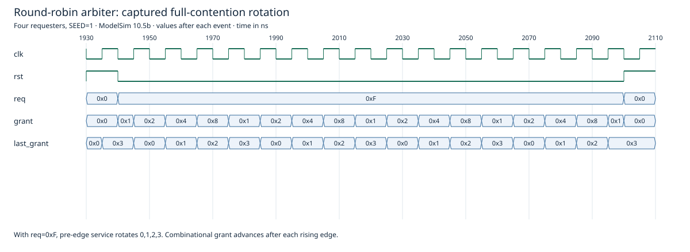

# Four-Requester Round-Robin Arbiter

A SystemVerilog arbiter with four request inputs, a one-hot combinational grant output, and a registered last-grant index. Existing RTL is preserved unchanged. No existing testbench was found in the inspected source/project locations; a new self-checking procedural testbench is included.

## Interface and decisions

| Signal | Behavior |
| --- | --- |
| `clk` | Rising edges record the currently selected requester |
| `rst` | Synchronous active-high reset sets the last-granted index to 3 |
| `req[3:0]` | Four same-clock binary requests, one per requester |
| `grant[3:0]` | One-hot selection among active requests; zero when no request is active |

Priority starts immediately after the remembered requester and wraps through all four inputs. Reset therefore makes requester 0 highest priority, followed by 1, 2, 3. With all requests continuously asserted, service at rising edges rotates **0 → 1 → 2 → 3 → 0**. Idle cycles retain the last-granted index; they do not restart priority.

The explicit four-way case statement makes the rotation readable. The index register needs only two bits. This module is **fixed at four requesters**, not parameterized. `grant` is combinational, so it can change when requests change and again after a clock edge updates the index. It is not a registered or glitch-free output. Requests must obey ordinary synchronous setup/hold requirements; no CDC handling is provided.

There is no `grant_ready`, acknowledgment, enable, or lock signal. The design assumes each grant is serviced at the sampling edge; priority rotates whenever a grant is active, even if an external consumer cannot accept it. It does not hold a grant throughout a multi-cycle transaction. Reset affects the index but does **not** gate off the combinational grant: with requests asserted, a grant can remain active during reset. Integrations needing accepted-transfer rotation or grant locking require a different interface; none was added to the preserved RTL.

## Actual verification

Executed October 13, 2026 (America/Los_Angeles), with ModelSim Intel FPGA Starter Edition 10.5b. Compilation and all three runs reported zero errors and zero warnings.

| Seed | Checked non-reset cycles | Priority-state/request-mask pairs | Result |
| --- | --- | --- | --- |
| 1 | 10,211 | 64/64 | PASS |
| 42 | 10,211 | 64/64 | PASS |
| 2026 | 10,211 | 64/64 | PASS |

Each run checks:

- All four reachable priority states against all 16 binary request masks, using a loop-based reference selector independent of the RTL's explicit case implementation.
- One-hot-or-zero grants, selection only from active requests, and a nonzero grant for nonzero binary requests.
- Pre-edge selection and the post-edge combinational rotation.
- Balanced full contention: each requester served four times over 16 sampling edges.
- Every nonempty persistent request subset, with every active requester served within four sampling edges.
- Persistent-request wait bound of at most three other service edges during randomized traffic.
- Idle retention and reset priority with requests both absent and asserted.
- 10,000 deterministic xorshift-driven request cycles per seed, plus directed setup/checks.

Fatal diagnostics, a timeout, and explicit pass/completion markers make failures detectable. The table represents functional combination checks, not tool-generated code coverage or formal proof. X/Z inputs, clock-domain crossings, arbitrary multi-cycle transactions, timing closure, synthesis, and physical FPGA operation were not validated. No source-specific synthesis reports were identified.

## Reproduce

Use PowerShell and ModelSim/Questa with SystemVerilog support. Put `vsim`, `vlog`, and `vlib` on PATH, or provide an executable path. From this folder:

```powershell
./sim/run.ps1
# Inspected installation:
./sim/run.ps1 -Simulator 'C:\intelFPGA\18.1\modelsim_ase\win32aloem\vsim.exe'
```

Success prints `PASS: all three arbiter regression seeds completed, each covering 64 priority/request combinations.` Generated libraries, transcripts, and VCD go in ignored `build/`. Actual logs are in [`reports/`](reports/). Other simulators were not tested.



This is an excerpt from the actual seed-1 VCD during the full-contention check. Bus values are hexadecimal: grant 1/2/4/8 identifies requesters 0/1/2/3. The grant changes after a rising edge updates `last_grant`; the pre-edge grant is the serviced selection. Optional regeneration requires Node.js: `node sim/render-waveform.mjs` after simulation.

## Publication review

The original file was found at `C:\altera\13.1\round_robin_arbiter.sv`, next to the located FIFO sources. Only this selected source is included from that directory; vendor tool/IP files and compiled artifacts are excluded. No third-party attribution notice, credential pattern, or applicable course-sharing restriction was found in the selected files. Inspection cannot independently establish original authorship or sharing policy. No license was assigned automatically. Source hashes are in [`reports/AUDIT.md`](reports/AUDIT.md).

The owner explicitly approved publication of this package under `projects/round_robin_arbiter`. No RTL changes, synthesis run, or hardware testing were performed.
