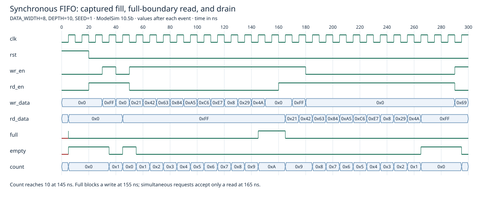

# Parameterized Synchronous FIFO

A single-clock SystemVerilog FIFO with registered read data, explicit pointer wrap, and occupancy-based full/empty flags. The existing RTL and original randomized testbench are preserved unchanged. Added procedural regressions make boundary and parameter checks executable in ModelSim Starter.

## Interface and behavior

| Signal | Meaning |
| --- | --- |
| `clk`, `rst` | Sole clock; synchronous active-high reset |
| `wr_en`, `wr_data` | Request a write; accepted at a rising edge when not full and not resetting |
| `rd_en`, `rd_data` | Request a read; accepted when not empty and not resetting; read data updates after that edge |
| `full`, `empty` | Derived from occupancy; reset makes the FIFO empty |

`DATA_WIDTH` defaults to **128**, `DEPTH` to **256**; both must be positive. A downstream synchronous consumer can sample the registered result at the following edge. This is not a fall-through/show-ahead FIFO: `rd_data` holds its last value when no read is accepted and resets to zero. Reset clears pointers and occupancy, discards queued words, and does not clear the memory array.

Writes are qualified with `!full`, reads with `!empty`, based on pre-edge occupancy. Simultaneous accepted operations preserve occupancy and read the old head. At full, a simultaneous read/write request accepts **only the read**; at empty it accepts **only the write**, with no bypass. At depth 1, no read and write can be accepted simultaneously. These conservative boundary semantics are deliberate properties of the existing RTL, not a full-rate replacement FIFO.

## Design decisions

- Separate read/write pointers wrap explicitly at `DEPTH-1`, supporting non-power-of-two depths.
- Pointer width is at least one bit, including depth 1. Count width is `$clog2(DEPTH+1)` so the full occupancy value is representable.
- A word array stores payloads, with synchronous read output and independent accepted operations.
- An occupancy counter changes only for a write-only or read-only accepted operation; flags are combinational comparisons against zero/depth.

This is a single-clock design, not a clock-domain crossing FIFO. The RTL does not validate invalid parameter settings or expose explicit write/read acknowledgments; consumers must use the documented enable/flag rules. Memory mapping, BRAM inference, timing closure, and resource utilization were not synthesized or established.

## Actual verification

Executed October 13, 2026 (America/Los_Angeles), with ModelSim Intel FPGA Starter Edition 10.5b.

| Width | Depth | Seeds | Added regression result |
| --- | --- | --- | --- |
| 1 | 1 | 1, 42 | 2/2 PASS |
| 8 | 2 | 1, 42 | 2/2 PASS |
| 8 | 10 | 1, 42 | 2/2 PASS |
| 32 | 16 | 1, 42 | 2/2 PASS |
| 128 | 256 | 1, 42 | 2/2 PASS |

Every added run uses 10,000 deterministic pseudorandom cycles plus directed tests for empty reads, full writes, simultaneous boundary requests, interior simultaneous operations where possible, repeated pointer wrapping, occupied reset with requests asserted, read-data hold, and final draining. A queue reference model checks payload ordering and flags/count before/after edges. Fatal checks and a watchdog report failures. All ten runs completed with zero simulation errors or warnings and final queue size zero. Accounting includes words intentionally discarded by reset.

The existing 10,000-operation width-8/depth-10 scoreboard completed without errors: **2,502 write-only operations, 2,499 read-only operations, 2,249 simultaneous operations, 255 blocked writes, 234 blocked reads, three words remaining**. It does not drain the FIFO at completion and releases reset on a rising edge. ModelSim Starter explicitly warned that its concurrent assertions require Questa; assertion/cover properties were not validated. The compiler also warned about those unsupported features. The new procedural tests avoid the original reset-edge race and add a checked drain.

See [`reports/RESULTS.md`](reports/RESULTS.md) and the actual transcripts. No formal proof, exhaustive parameter/seed coverage, coverage closure, synthesis run, or physical FPGA testing is claimed.

## Reproduce

Requirements: PowerShell and ModelSim/Questa with SystemVerilog support. Put `vsim`, `vlog`, and `vlib` on PATH, or supply the simulator executable. From this folder:

```powershell
./sim/run.ps1
# Inspected local installation:
./sim/run.ps1 -Simulator 'C:\intelFPGA\18.1\modelsim_ase\win32aloem\vsim.exe'
```

The wrapper checks each pass marker, actual completion, and error/fatal diagnostics. Generated libraries, logs, and VCD go in ignored `build/`. Its final message notes that original SVA/coverage is unsupported by Starter; support depends on the simulator edition. Other simulators were not tested.



This excerpt comes from the actual width-8/depth-10/seed-1 regression VCD. It shows filling, a blocked full write, the conservative full read/write boundary, and draining. Bus labels are hexadecimal. Optional regeneration needs Node.js: `node sim/render-waveform.mjs` after simulation. The complete raw VCD is regenerated in `build/` and is not tracked.

## Publication review

ModelSim project metadata identified the original source files at `C:\altera\13.1\sync_fifo.sv` and `sync_fifo_tb.sv`; they were stored outside the initial FPGA-folder search. This package includes only those selected sources and newly added verification/documentation, not surrounding vendor installation files or compiled-library stubs. No third-party attribution notice, credential pattern, or applicable course-sharing restriction was found in selected files; this inspection cannot independently establish authorship or sharing policy. No license was assigned automatically.

[`reports/AUDIT.md`](reports/AUDIT.md) records preserved source hashes. No synthesis report tied to this source revision was identified. The owner explicitly approved publishing this package under `projects/sync_fifo`. The located four-requester round-robin arbiter is the next review candidate and is not included here.
