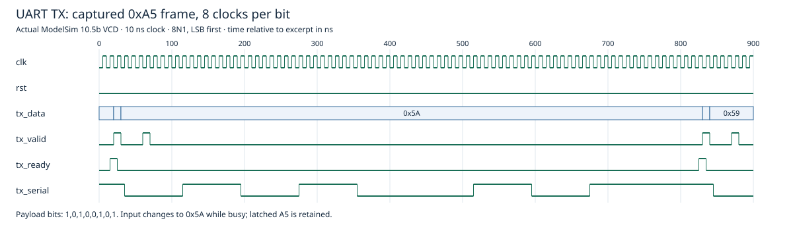

# UART Transmitter and Receiver

A synthesizable-style SystemVerilog **8N1 UART core**: one start bit, eight data bits transmitted least-significant bit first, and one stop bit. This package includes a transmitter, receiver, and a combined wrapper. The existing RTL is preserved unchanged; validation is simulation-only.

## Modules and design decisions

| Module | Interface and behavior |
| --- | --- |
| `uart_tx` | Accepts `tx_data` with `tx_valid` while idle, lowers `tx_ready` while serializing, and returns the line high during idle/stop. The byte is latched so later input changes do not alter a frame. |
| `uart_rx` | Passes the serial input through two synchronization registers, confirms the start bit near its midpoint, samples data once per bit, and accepts a frame only when the stop bit is high. Outputs a one-clock `rx_valid` pulse with `rx_data`. |
| `uart` | Instantiates the TX and RX cores with a common `CLKS_PER_BIT` setting; provides independent parallel transmit and receive interfaces. |

All modules use one clock and synchronous active-high `rst`. `CLKS_PER_BIT` is an integer divider: nominal baud = clock frequency / `CLKS_PER_BIT`. The wrapper defaults to 434 clocks per bit (approximately 115,207 baud at 50 MHz). TX defaults to 4; RX defaults to 8. Configure both explicitly when using them together. Restrict use to `CLKS_PER_BIT >= 2`; the existing counter declarations and RX half-bit calculation do not support 1 reliably. Only TX=4 and TX/RX=8 were tested here; default 434 and other divisors were not validated.

The TX ready/valid signals apply to whole bytes. A producer should present stable data/valid through an accepting edge and stop sending while busy. There is an internal clock of delay between byte acceptance and the start-bit falling edge. The receiver has no `rx_ready`, receive FIFO, parity, explicit framing-error output, or break detector. A consumer must capture each valid pulse. Invalid stop bits cause the frame to be discarded. The two-register synchronizer is a design measure; simulation does not characterize metastability or establish hardware CDC reliability. Single-point sampling has less noise tolerance than an oversampling receiver.

## Actual verification

ModelSim Intel FPGA Starter Edition 10.5b was used on October 12–13, 2026 (America/Los_Angeles). All selected testbenches compiled without errors or warnings. No changes to existing RTL/testbenches were needed.

| Testbench | Actual result | Scope |
| --- | --- | --- |
| Existing `uart_tx_tb` | Completed, no diagnostics | Smoke stimulus only: not a self-checking functional pass |
| Existing `uart_tx_tb_extended` | Completed, no errors | Serial A5 frame remains correct despite input changes and a busy-time valid pulse |
| Existing `uart_rx_tb` | PASS | False-start rejection and recovery to A5 |
| Existing `uart_loopback_tb` | Completed, no errors | Five TX→RX bytes: A5, 3C, 00, FF, 55 |
| Added `rx_edges_tb` | PASS, 3 valid frames | Bad-stop rejection, 00/FF/A5, reset abort/recovery, one-clock valid pulses |
| Added `tx_all_bytes_tb` | PASS, 256 frames | Every 8-bit payload, input latching, start/data/stop samples, busy-time valid rejection |

Raw logs are in [`reports/`](reports/). The added tests use fatal assertions and timeouts. Existing tests lack watchdogs, so the simulation script uses bounded runs and the wrapper requires an actual `$finish`/`$stop` completion marker, rejecting error/fatal diagnostics. The basic TX test is reported separately as smoke evidence.

These tests do not establish exact bit-transition timing, operation across baud mismatch/jitter/noise, a full divisor sweep, exhaustive back-to-back receive behavior, formal proof, synthesis, timing closure, or operation on a physical FPGA. No board constraints, programming files, or verified synthesis reports were found for this core.

## Reproduce

Use PowerShell and ModelSim/Questa with SystemVerilog support. Put `vsim`, `vlog`, and `vlib` on PATH, or supply the simulator path. From this project folder:

```powershell
./sim/run.ps1
# Inspected installation:
./sim/run.ps1 -Simulator 'C:\intelFPGA\18.1\modelsim_ase\win32aloem\vsim.exe'
```

The wrapper prints `PASS: UART checked tests completed; basic TX smoke completed.` It creates ignored libraries, transcripts, and a transmitter VCD under `build/`. Other simulators were not tested.



This excerpt is rendered from the actual added TX test's VCD. It shows an A5 frame and changed parallel inputs while the transmitter is busy. Optional regeneration needs Node.js: `node sim/render-waveform.mjs`. Raw VCD is generated in `build/` and excluded from publication.

## Selection and publication review

Three completed RTL modules, four existing testbenches, and two new focused testbenches are included. The incompatible older `uart_comm` transmitter is excluded to avoid a duplicate `uart_tx` module/interface; it separately passed its existing 1,000 randomized frame checks. The unfinished `uart_register.sv` stub is excluded.

The echo wrapper is excluded: a new 256-frame zero-gap stress test received only 253 frames, demonstrating that its one-byte pending buffer is not lossless for sustained traffic. The LED command demo passed its four existing paced checks but is excluded from this core package; its single pending response can be overwritten under heavier query traffic, and that traffic limit has not been verified.

No third-party source notices or sharing restrictions were found in the selected source files. This inspection cannot independently establish authorship or course policy. No license was assigned automatically. Original RTL/testbench contents are preserved. Generated databases and large existing VCDs are excluded. The owner explicitly approved publishing this selected TX/RX core under `projects/uart` in the portfolio repository.
